# 🏗️ Etapa 1: Contexto e Planejamento da Solução Distribuída

Este documento serve como diretriz mestre e repositório de evidências para a **Etapa 1: Contexto e Planejamento da Solução**. Ele foi estruturado de forma a facilitar o acompanhamento e auto-gestão das atividades pelos alunos.

---

## 🎯 Rubricas de Avaliação desta Etapa

Ao final desta Etapa, cada aluno será avaliado individualmente nestas 5 competências:

1. **H26a-ADS-CST: Definir o problema de forma clara e objetiva, apresentando os objetivos, a justificativa e a motivação da escolha**: Definir o problema de forma clara e objetiva, apresentando os objetivos, a justificativa e a motivação da escolha (Medido na seção [Catálogo de Serviços Web](#-catalogo-de-servicos-web)).
2. **H26b-ADS-CST - Identificar os perfis de usuários, investigar suas necessidades e elaborar Personas.**: Identificar os perfis de usuários, investigar suas necessidades e elaborar Personas. (Medido na seção [Arquitetura da Solução](#-arquitetura-da-solucao)).
3. **H26c-ADS-CST - Definir os requisitos funcionais e não funcionais do projeto de acordo com o contexto levantado**: Definir os requisitos funcionais e não funcionais do projeto de acordo com o contexto levantado (Medido na seção [Especificação de Contratos de APIs](#-especificacao-de-contratos-de-apis)).
4. **H24a-ADS-CST - Definir e documentar a arquitetura da aplicação distribuída**: Definir e documentar a arquitetura da aplicação distribuída (Medido na seção [Projeto do Frontend Web](#-projeto-do-frontend-web)).
---

## 📅 Cronograma do Semestre (Semana → Período)

Esta tabela é a referência única de planejamento semanal do projeto, usada por todas as Etapas. Ela usa **número relativo de semana** (Semana 1, Semana 2...), não datas fixas, para que o template continue válido em qualquer semestre — cada turma ancora a "Semana 1" na semana real de início da disciplina.

| Semana | Etapa | Atividade Prevista |
| :---: | :---: | :--- |
| 1 | 1 | Apresentação do Projeto |
| 2 | 1 | Definição dos Temas e Organização dos Grupos |
| 3 | 1 | Especificações do Projeto |
| 4 | 1 | Arquitetura da Solução |
| 5 | 2 | Desenvolvimento de Funcionalidades - API (inclui apresentação da Etapa 1) |
| 6 | 2 | Desenvolvimento de Funcionalidades - API |
| 7 | 2 | Desenvolvimento de Funcionalidades - API |
| 8 | 2 | Desenvolvimento de Funcionalidades - API |
| 9 | 2 | Testes - API |
| 10 | 3 | Desenvolvimento de Funcionalidades - Web (inclui apresentação da Etapa 2) |
| 11 | 3 | Desenvolvimento de Funcionalidades - Web |
| 12 | 3 | Desenvolvimento de Funcionalidades - Web |
| 13 | 3 | Testes - Front-End Web |
| 14 | 4 | Desenvolvimento de Funcionalidades - Mobile (inclui apresentação da Etapa 3) |
| 15 | 4 | Desenvolvimento de Funcionalidades - Mobile |
| 16 | 4 | Desenvolvimento de Funcionalidades - Mobile |
| 17 | 4 | Testes - Front-End Mobile |
| 18 | 5 | Apresentação Final do Projeto |

*As Semanas 1 e 2 não possuem tarefa de documentação associada (organização inicial do grupo e apresentação do projeto).*

---

## 📅 QUADRO DE CONTRIBUIÇÃO REAL (ETAPA 1)

**Atenção alunos:** Preencham esta tabela para atualizar o andamento das tarefas e quem foi o responsável por cada entrega. Garanta que o nome, usuário do GitHub e o link para a seção onde está o seu trabalho estejam devidamente preenchidos.

- **Status admitidos**: `⌛ Não Iniciado` | `📝 Em Progresso` | `✔️ Entregue`
- **Autoria Git**: Indica se há commits desse estudante modificando a seção correspondente.

**Atividades Semanais desta Etapa** (ver [Cronograma do Semestre](#-cronograma-do-semestre-semana--periodo)):
- `ATV1.1` — Especificações do Projeto (Semana 3)
- `ATV1.2` — Arquitetura da Solução (Semana 4)

| Rubrica Curricular | ID Tarefa | Atividade Semanal | Descrição Detalhada da Tarefa | Estudante Responsável | GitHub Username | Status de Entrega | Evidência/Seção Temática | Autoria Git |
| :---: | :---: | :---: | :--- | :--- | :---: | :---: | :--- | :---: |
| **H26a** | `T1.1` | `ATV1.1` | Definição do Problema, Objetivos e Justificativa | João Pedro Lopes | `JoaoLopes994` | `✔️ Entregue` | [Seção 1](#11-problema-objetivos-e-justificativa) | [ ] |
| **H34a** | `T1.2` | `ATV1.1` | Descrição das Personas e Mapa de Stakeholders | Pedro Ivo | `PedroD98` | `✔️ Entregue` | [Seção 1.2](#12-personas-e-stakeholders) | [ ] |
| **H34a** | `T1.3` | `ATV1.1` | Definição de Requisitos Funcionais e Priorização | Julio de Oliveira | `xSC4Rx` | `✔️ Entregue` | [Seção 2.1](#21-requisitos-funcionais-e-não-funcionais) | [ ] |
| **H34a** | `T1.4` | `ATV1.1` | Catálogo de Serviços Web e Acordos de SLA | Raphael Yankous Machado Clemente | `RaphaelYankous` | `✔️ Entregue` | [Seção 3.0](#-catalogo-de-servicos-web) | [ ] |
| **H35a** | `T1.5` | `ATV1.2` | Diagrama de Componentes Físico e Lógico da Solução | Pedro Ivo | `PedroD98` | `✔️ Entregue` | [Seção 4.1](#41-diagrama-de-arquitetura) | [ ] |
| **H35a** | `T1.6` | `ATV1.2` | Definição das Tecnologias Distribuídas e Hospedagem | Kelven Rodrigues da Silva | `puckelvensilva` | `✔️ Entregue` | [Seção 4.2](#42-tecnologias-e-hospedagem) | [ ] |
| **H36a** | `T1.7` | `ATV1.2` | Especificação de Contratos de API (Endpoints/Verbos) | Kelven Rodrigues da Silva | `puckelvensilva` | `✔️ Entregue` | [Seção 5.0](#-especificacao-de-contratos-de-apis) | [ ] |
| **H37a** | `T1.8` | `ATV1.2` | Wireframes do Frontend Web e Fluxograma de Navegação | Vinícius Claret Nunes | `viniciusclaretnuns` | `✔️ Entregue` | [Seção 6.0](#-projeto-do-frontend-web) | [ ] |
| **H38a** | `T1.9` | `ATV1.2` | Wireframes do Frontend Móvel e Fluxo de Gestos | Leticia Beatriz da Silva | `leticiabeatrizs` | `✔️ Entregue` | [Seção 7.0](#-projeto-do-frontend-movel) | [ ] |

---

# 1. Introdução e Contexto

[Esta seção introduz o contexto de negócios e define os limites do problema.]

## 1.1. Problema, Objetivos e Justificativa

* **O Problema**:
 Barbearias e salões de beleza no Brasil costumam gerenciar suas agendas de forma manual: cadernos, planilhas ou combinados por WhatsApp. Isso gera choques de horário entre clientes de um mesmo profissional, ociosidade em períodos de baixo movimento e nenhuma forma clara de saber qual profissional está rendendo mais para o negócio. Para o cliente, o problema é parecido: ferramentas como o Google Maps mostram que o estabelecimento existe, mas não dizem quem está livre, em qual horário, nem para qual serviço — sobrando a ele ligar ou mandar mensagem até achar um encaixe.
O problema pesa mais quando se olha o tamanho do setor. Segundo o Sebrae, o Brasil já tem mais de 1,3 milhão de empresas de beleza ativas, e o ritmo de abertura de novos negócios chegou a 27 por hora em 2025, com faturamento crescendo 18,5% no ano (SEBRAE, 2025). Quanto mais estabelecimentos estiverem concorrendo numa mesma região, mais decisivo se torna organizar bem a agenda internamente e aparecer para o cliente certo, na hora certa.


* **Objetivo Geral**:
  Desenvolver uma plataforma de gerenciamento para barbearias e salões de beleza, unindo o controle do lojista sobre loja, profissionais e agendas à busca de serviços por parte do cliente com base na sua localização.

* **Objetivos Críticos**:
  1. Implementar uma API que integre os dados de estabelecimentos, profissionais e horários entre o painel do lojista e o app do cliente
  2. Criar uma busca geolocalizada onde o cliente filtra por serviço, avaliação e horário disponível, e agenda direto pelo sistema.
  3. Garantir que a agenda dos profissionais não sofra conflitos de horário mesmo com vários acessos simultâneos.


* **Justificativa**:
 O setor de beleza é um dos que mais crescem entre pequenos negócios no Brasil: só entre janeiro e setembro de 2024 foram abertos mais de 170 mil novos negócios do ramo, quase 700 por dia (SEBRAE, 2025). São, em geral, negócios pequenos, com pouco investimento e sem estrutura para sistemas caros ou complexos — o que justifica uma solução acessível e direta ao ponto. Some-se a isso o fato de que 62% dos consumidores já pagam mais por atendimento personalizado, segundo o mesmo levantamento, o que reforça a necessidade de conectar o cliente a um profissional específico, e não só a um estabelecimento genérico, na região onde ele está.

---

## 1.2. Personas e Stakeholders

### Persona 1: Roberto Silva (Dono de Estabelecimento)
- **Perfil e Atitude**: 45 anos, dono de uma barbearia com 4 cadeiras. Tem familiaridade moderada com tecnologia; usa o smartphone o dia todo para WhatsApp e redes sociais, mas prefere fazer tarefas de gestão sentado em frente a um computador ou notebook para ter uma visão mais ampla.
- **Frustração**: Perde muito tempo gerenciando agendamentos pelo WhatsApp ou no caderno. Agendamentos duplicados, confusão nos dias de folga dos seus barbeiros e tempo perdido avisando clientes quando um profissional falta são dores do seu dia a dia.
- **Como a Solução o Ajuda**: Utilizará a aplicação web para cadastrar a barbearia, configurar os serviços, e definir a escala de trabalho dos profissionais. O sistema o ajuda automatizando os agendamentos, bloqueando horários indisponíveis e notificando os clientes automaticamente sobre cancelamentos, tirando esse peso operacional de suas costas.

### Persona 2: Sônia Albuquerque (Dona de Estabelecimento)
- **Perfil e Atitude**: 52 anos, proprietária de uma clínica de estética e salão de beleza de médio porte. Tem familiaridade intermediária com tecnologia; usa sistemas básicos de caixa, mas depende de planilhas complexas e papéis para análises mais profundas.
- **Frustração**: Tem muita dificuldade em medir o desempenho da sua equipe e entender a saúde financeira do negócio. Sofre no fim do mês tentando cruzar dados para descobrir quais serviços dão mais lucro, qual profissional atrai mais clientes e como está a satisfação geral do público.
- **Como a Solução o Ajuda**: Utilizará a aplicação web, focando fortemente no dashboard. A solução entrega valor direto ao compilar automaticamente dados estatísticos precisos (volume de agendamentos, serviços mais populares, ranking de profissionais e avaliações gerais). Isso permite que ela tome decisões estratégicas baseadas em dados reais.

### Persona 3: Mariana Costa (Profissional)
- **Perfil e Atitude**: 29 anos, nail designer (manicure especializada) que atua como parceira em um grande salão. Familiaridade alta com aplicativos móveis, usa o smartphone constantemente entre um atendimento e outro.
- **Frustração**: Presta um serviço de altíssima qualidade, mas fica desmotivada por não ter um retorno claro sobre o que os clientes acharam. Além disso, irrita-se com a falta de organização da recepção do salão, que às vezes gera intervalos ociosos muito longos entre os clientes sem avisá-la.
- **Como a Solução o Ajuda**: Utilizará a aplicação para ter controle total sobre a visualização de sua rotina diária. A solução a ajuda garantindo que ela veja sua agenda sempre atualizada e sem buracos surpresa. Além disso, o sistema de avaliações implementado no fluxo permite que ela saiba que seu trabalho está sendo reconhecido e bem avaliado.

### Persona 4: João Pedro (Profissional)
- **Perfil e Atitude**: 32 anos, cabeleireiro parceiro em um grande salão de beleza. Muito habituado a usar aplicativos móveis e redes sociais, sempre com o celular no bolso do avental.
- **Frustração**: Não tem controle ou previsibilidade do seu próprio dia de trabalho. Irrita-se quando precisa interromper algo para ir até a recepção (ou perguntar ao dono) quem é o próximo cliente, se houve algum cancelamento ou que horas é seu intervalo.
- **Como a Solução o Ajuda**: Utilizará a aplicação apenas para visualizar sua agenda atualizada em tempo real. O valor extraído é a previsibilidade e a autonomia, permitindo que ele saiba exatamente como será o seu dia sem depender de comunicação constante com o dono do salão.

### Persona 5: Camila Mendes (Cliente)
- **Perfil e Atitude**: 28 anos, advogada, alta familiaridade com tecnologia e ferramentas móveis. Resolve praticamente tudo da sua vida pelo celular, valoriza a autonomia e detesta processos lentos.
- **Frustração**: Não gosta de ter que ligar para o salão ou mandar mensagem e esperar horas para que a recepção envie os horários disponíveis da sua manicure favorita. Fica muito frustrada quando um imprevisto acontece no salão e ela dá viagem perdida por não ter sido avisada a tempo.
- **Como a Solução o Ajuda**: Utilizará a aplicação mobile para buscar salões próximos ao seu endereço, checar as agendas em tempo real e marcar seu horário em poucos cliques. O valor direto extraído é a conveniência, além da segurança de receber um e-mail de aviso caso o estabelecimento cancele o horário, evitando viagens perdidas.
  
### Mapa de Interesses dos Stakeholders:
- **Stakeholders Diretos (Atores principais)**: Donos/Gerentes dos estabelecimentos de beleza (usuários focados na aplicação web para gestão), Clientes finais (usuários focados na aplicação mobile para busca e agendamento) e Profissionais de beleza (usuários da aplicação web/mobile para consulta de rotina).
- **Stakeholders Indiretos (Quem é alterado pelo sistema)**: Desenvolvedores e mantenedores do software, Provedores de serviços de e-mail (infraestrutura terceirizada responsável pelos disparos automáticos de cancelamento) e Provedores de mapas/geolocalização (serviços terceirizados impactados pelas buscas de estabelecimentos próximos).

---

# 2. Especificações do Projeto

## 2.1. Requisitos Funcionais e Não Funcionais

### Requisitos Funcionais (RF)

| ID | Descrição do Requisito | Canal Prático (Onde ocorre?) | Prioridade | Rubrica Associada |
| :---: | :--- | :---: | :---: | :---: |
| `RF-001` | O sistema deve permitir cadastro e login diferenciando os perfis de Administrador/Lojista, Profissional e Cliente em ambas as plataformas | Web e Mobile | Alta | `H37a` |
| `RF-002` | O Administrador deve poder gerenciar o estabelecimento, definindo dados de contato, endereço, horários de abertura/fechamento e dias de funcionamento e serviços ofertados. | Web e Mobile | Alta | `H38a` |
| `RF-003` | O sistema deve permitir ao Administrador cadastrar profissionais vinculados ao estabelecimento, definindo horários de expediente individual, dias de trabalho e especialidades. | API / Backend | Alta | `H36a` |
| `RF-004` | O sistema deve permitir ao Administrador cadastrar serviços individuais e combos com valor e tempo de duração estimado parametrizado. | Web | Alta | `H37a` |
| `RF-005` | O sistema deve calcular dinamicamente e exibir para o cliente apenas intervalos contínuos de horários livres compatíveis com a duração total do serviço ou combo selecionado. | Móvel | Alta | `H38a` |
| `RF-006` | O cliente deve poder agendar serviços escolhendo barbearia, profissional, serviço/combo, data e horário, com suporte completo tanto via Web quanto via aplicativo móvel. | API / Backend | Alta | `H36a` |
| `RF-007` | O profissional deve poder visualizar sua própria agenda de atendimentos em tempo real por meio do aplicativo móvel ou navegador Web. | Web | Alta | `H37a` |
| `RF-008` | O sistema deve permitir o registro de bloqueios de agenda e folgas (férias, imprevistos ou ausências pontuais) por profissional, impedindo novas reservas no período. | Móvel | Alta | `H38a` |
| `RF-009` | O sistema deve permitir o cancelamento de agendamentos pelo cliente ou pelo estabelecimento, liberando automaticamente o horário na grade em todas as plataformas. | API / Backend | Alta | `H36a` |
| `RF-010` | O sistema deve disparar notificações e e-mails de confirmação, lembrete e cancelamento de agendamentos para os usuários envolvidos. | API / Backend | Média | `H36a` |
| `RF-011` | O sistema deve permitir que o cliente busque e ordene estabelecimentos por proximidade via geolocalização ou endereço cadastrado (Web e Mobile). | Móvel | Média | `H38a` |
| `RF-012` | O Administrador deve dispor de um painel de métricas analíticas com histórico de atendimentos, faturamento, fluxo de clientes, serviços mais procurados e profissionais de destaque. | API / Backend | Média | `H36a` |
| `RF-013` | O sistema deve permitir que o cliente envie avaliações e comentários após a conclusão do serviço. | Web | Baixa | `H37a` |
| `RF-014` | O sistema deve permitir que o cliente acumule pontos por meio dos serviços realizados no estabelecimento e, ao atingir a quantidade necessária, utilize seus pontos para trocar por serviços disponíveis, realizando a validação do saldo e registrando o resgate no histórico. | Móvel | Baixa | `H38a` |

### Requisitos Não Funcionais (RNF)

| ID | Descrição do Requisito Técnico | Categoria | Prioridade | Rubrica Associada |
| :---: | :--- | :---: | :---: | :---: |
| `RNF-001` | A exibição de mapas e geolocalização deve utilizar bibliotecas JavaScript leves (ex.: Leaflet, GeoJSON) sem dependência mandatória de APIs proprietárias pagas. | Arquitetura / Custo | Média | `H38a`, `H35a` |
| `RNF-002` | O algoritmo de processamento e busca de slots de horários livres deve responder com tempo inferior a 3 segundos. | Desempenho | Alta | `H36a`, `H35a` |
| `RNF-003` | O sistema deve aplicar controle de acesso baseado em papéis (RBAC) com isolamento completo de dados entre estabelecimentos e restrições por perfil. | Segurança | Alta | `H38a`, `H35a` |
| `RNF-004` | A aplicação deve fornecer interfaces responsivas sincronizadas via API centralizada (Node.js), atendendo a navegadores Web (React) e dispositivos móveis (React Native). | Compatibilidade / Usabilidade | Alta | `H36a`, `H35a` |
| `RNF-005` | O backend deve assegurar consistência transacional e bloqueio pessimista/otimista para prevenir agendamentos duplicados no mesmo horário (*double booking*). | Confiabilidade / Integridade | Alta | `H38a`, `H35a` |
| `RNF-006` | Credenciais, senhas e tráfego de dados devem utilizar criptografia segura. | Segurança | Alta | `H36a`, `H35a` |


---

### 3. Catálogo de Serviços Web

*(Esta seção atende diretamente à rubrica **H34a**)*

A lógica de TI deste sistema foi estruturada sob o modelo de Aplicações Distribuídas, visando garantir escalabilidade e alta disponibilidade para as plataformas Web e Mobile. Os serviços foram desacoplados em processos independentes e expostos via APIs centralizadas, permitindo que cada domínio do negócio evolua e seja escalado de maneira autônoma. 

Essa abordagem arquitetural permite isolar responsabilidades críticas — como a prevenção de conflitos de agenda (*double booking*) no core de agendamentos e o controle de acesso por papéis (RBAC) no serviço de identidade. Além de otimizar o tempo de resposta, o desacoplamento garante resiliência ao sistema e facilita a divisão de tarefas e manutenção independente de cada módulo pela equipe de engenharia.

Use a tabela abaixo para mapear a Gestão de Serviços de TI que o grupo irá disponibilizar:

| Serviço de TI | Canal de Comunicação | Nível de Serviço (SLA) Esperado | Mecanismo de Monitoração | Responsável |
| :--- | :---: | :---: | :--- | :---: |
| **Serviço de Autenticação e Perfis (Identity)** <br> *(Gerencia acessos de Admin, Profissional e Cliente)* | JSON / HTTPS | 99.9% de uptime / Up em < 2s pós queda | LOGs de Auditoria / Middleware de telemetria | João Pedro Lopes da Silva |
| **API Core de Agendamentos** <br> *(Calcula horários livres dinamicamente e previne double booking)* | JSON / HTTPS | Tempo de resposta para busca de slots < 1s | Monitoramento de APM / Health Checks | Julio de Oliveira Nascimento |
| **Serviço de Catálogo e Gestão** <br> *(Gerencia dados da loja, dias de funcionamento, profissionais e combos)* | JSON / HTTPS | 99.5% de uptime / Resposta < 800ms | Monitoramento de taxa de acerto de cache | Kelven Rodrigues da Silva |
| **Serviço de Notificações** <br> *(Dispara e-mails e alertas de confirmação/lembrete)* | Mensageria / WebSockets | Processamento em no máximo 5 segundos | Fila Morta (Dead Letter Queues) | Leticia Beatriz da Silva |
| **Serviço de Analytics e Métricas** <br> *(Alimenta o painel corporativo com histórico de faturamento e fluxo)* | JSON / HTTPS | Atualização de dados assíncrona (D+1) | Logs de processamento em lote | Pedro Ivo Dias Ferreira da Silva |
| **Serviço de Mapas e Geolocalização** <br> *(Integração geoespacial para ordenação por proximidade)* | JSON / HTTPS | Resposta < 1s para consultas geoespaciais | Logs de requisição / Monitoramento de tráfego | Raphael Yankous Machado Clemente |
| **Serviço de Avaliações e Fidelidade** <br> *(Gerencia notas pós-atendimento e acúmulo de pontos/reputação)* | JSON / HTTPS | 99.5% de uptime / Tolerância a falhas parciais | Logs estruturados / Análise de sentimento | Vinícius Claret Nunes |

---

# 4. Arquitetura da Solução

*(Esta seção atende diretamente à rubrica **H35a**)*

## 4.1. Diagrama de Arquitetura

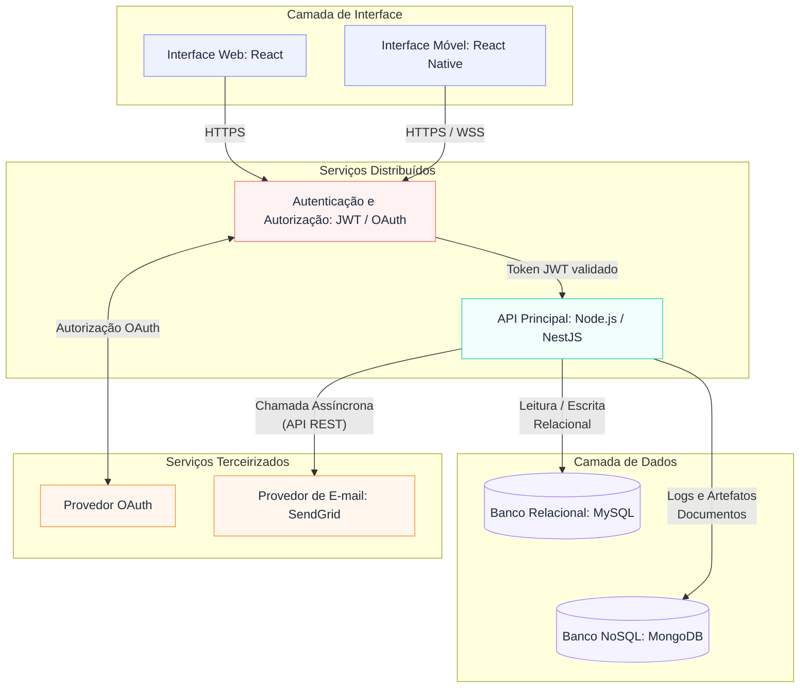

---

## 4.2. Tecnologias e Hospedagem

**Backend / API (Node.js, NestJS e Axios)**
* **O que escolhemos:** Node.js com NestJS e Axios.
* **Por que escolhemos:** Como o sistema é para agendamento de barbearia, a API precisa responder rápido quando várias pessoas tentam marcar horário ao mesmo tempo. O Node.js é ótimo nisso porque é leve e não trava esperando uma resposta para atender a próxima chamada. O NestJS entra para organizar a estrutura da API de forma modular, e o Axios facilita a conversa da nossa API com serviços de fora, como o provedor de e-mail.

**Autenticação e Autorização (JWT e OAuth)**
* **O que escolhemos:** JWT para validação de sessão e OAuth para login.
* **Por que escolhemos:** Fica como um serviço isolado que valida o token JWT e trata a autorização OAuth antes de liberar o acesso à API principal.

**Painel Web do Administrador (React.js)**
* **O que escolhemos:** React.js.
* **Por que escolhemos:** O dono da barbearia precisa de uma tela rápida para mexer na agenda e nos serviços sem ter que ficar recarregando a página toda hora. O React resolve isso mudando só o pedaço da tela que atualizou, deixando tudo mais fluido.

**Aplicativo do Cliente (React Native e Expo)**
* **O que escolhemos:** React Native usando Expo.
* **Por que escolhemos:** Como já usamos React Native no semestre passado, decidimos aproveitar a experiência do grupo. Além disso, o app precisa usar funções do próprio celular:
  * **Notificações:** Para avisar o cliente sobre o horário agendado.
  * **Memória do celular:** Para manter o cliente conectado sem pedir senha toda hora.

**Banco de Dados (MySQL e MongoDB)**
* **O que escolhemos:** MySQL e MongoDB
* **Por que escolhemos:** O MySQL cuida da parte principal, estruturando os dados relacionais para não deixar dois clientes marcarem o mesmo horário com o mesmo barbeiro. Já o MongoDB fica responsável por armazenar logs e artefatos, como documentos, que não precisam de uma estrutura relacional fixa.

**Envio de E-mail (SendGrid)**
* **O que escolhemos:** SendGrid.
* **Por que escolhemos:** Serviço terceirizado para envio de e-mails transacionais (ex: confirmação de agendamento).

**Onde vamos hospedar**
* **API e Banco de Dados:** Vamos usar serviços em nuvem como Render.
* **Painel Web:** Vai ficar na Vercel, que carrega as páginas de forma quase instantânea.
* **App Mobile:** Usamos o Expo Go para testar no celular enquanto desenvolvemos e depois geramos o arquivo de instalação (APK) para a entrega.

---

# 5. Especificação de Contratos de APIs

*(Esta seção atende diretamente à rubrica **H36a**)*

[Definição formal dos endpoints chaves de comunicação que servirão para o desenvolvimento na Etapa 2.]


---


### 5.1 Cadastro de Novo Cliente (App)

**Endpoint:** (`/api/v1/auth/register`)

- **Método**: `POST`

**Payload de Requisição**
```json
{
  "nome": "Lucas Mendes",
  "email": "lucas.mendes@email.com",
  "telefone": "(31) 97777-6666",
  "password": "senha_segura_123"
}
```

**Resposta de Sucesso — 201 Created**
```json
{
  "mensagem": "Usuário criado com sucesso",
  "token": "eyJhbGciOiJIUzI1NiIsInR5cCI6IkpXVCJ9...",
  "user": {
    "id": 42,
    "nome": "Lucas Mendes",
    "email": "lucas.mendes@email.com",
    "tipo": "cliente"
  }
}
```

### 5.2 Autenticação de Usuários

**Endpoint:** (`/api/v1/auth/login`)

**Método:** `POST`

### Payload de Requisição

```json
{
  "email": "carlos@email.com",
  "password": "123@mudar"
}
```

**Resposta de Sucesso — 200 OK**

```json
{
  "token": "eyJhbGciOiJIUzI1NiIsInR5cCI6IkpXVCJ9...",
  "expiresIn": 86400,
  "user": {
    "id": 1,
    "nome": "Carlos Silva",
    "email": "carlos@email.com",
    "tipo": "cliente"
  }
}
```

### 5.3 Estabelecimentos (barbearias/salões)

**Endpoint:** (`/api/v1/estabelecimentos`)

**Método:** `GET`

### Payload de Requisição
- **Query Params**: `lat`, `lng`, `raio`, `proximidade`, `servico`, `pagina`, `limite`

```json
{
    "total": 3,
    "estabelecimentos": [
      {
        "id": 1,
        "nome": "Barbearia Clássica",
        "foto_perfil": "...",
        "endereco": { "cidade": "Belo Horizonte", "uf": "MG" },
        "distancia_km": 1.2,
        "avaliacao_media": 4.8
      }
    ]
```

### 5.4 Listagem de Serviços Oferecidos (App e Web)

**Endpoint:** (`/api/v1/servicos`)

- **Método**: `GET`

**Resposta de Sucesso — 200 OK**

```json
{
  "totalServicos": 3,
  "servicos": [
    {
      "id": 1,
      "nome": "Corte de Cabelo",
      "descricao": "Corte degradê, social ou máquina",
      "duracaoMinutos": 30,
      "preco": 45.00
    },
    {
      "id": 2,
      "nome": "Barba Completa",
      "descricao": "Barboterapia com toalha quente",
      "duracaoMinutos": 30,
      "preco": 35.00
    },
    {
      "id": 3,
      "nome": "Combo (Cabelo + Barba)",
      "descricao": "Corte de cabelo e barboterapia completa",
      "duracaoMinutos": 60,
      "preco": 70.00
    }
  ]
}
```

### 5.5 Listagem de Horários Disponíveis
**Endpoint:** (`/api/v1/agendamentos/horariosDisponiveis`)
- **Método**: `GET`

**Payload de Requisição**

```json
{
  "data": "2026-09-10",
  "barbeiroId": 2,
  "horariosDisponiveis": [
    "09:00",
    "10:00",
    "11:00",
    "14:00",
    "15:30"
  ]
}
```

### 5.6 Agendamentos
**Endpoint:** (`/api/v1/agendamentos/disponibilidade`)
- **Método**: `GET`

**Payload de Requisição**
- **Query Params**: `estabelecimento_id`, `profissional_id`, `cliente_id`, `status`, `todos opcionais`

**Resposta de Sucesso — 200 OK**

  ```json
  {
    "agendamentos": [
      { "id": 10, "cliente": "Pedro Ivo", "profissional": "Kelven Rodrigues", "servico": "Corte Clássico", "dataHora": "2026-09-08T14:00:00-03:00", "status": "pendente" }
    ]
  }
  ```

### 5.7 Criação de Novo Agendamento pelo Aplicativo

**Endpoint:** (`/api/v1/agendamentos`)

- **Método**: `POST`

Cabeçalho
Authorization: Bearer <TOKEN_JWT>

**Payload de Requisição**
```json
{
  "barbeiroId": 2,
  "servicoId": 1,
  "dataHora": "2026-09-10T10:00:00Z"
}
```

**Resposta de Sucesso — 201 Created**
```json
{
  "id": 105,
  "status": "confirmado",
  "dataHora": "2026-09-10T10:00:00Z",
  "servico": {
    "id": 1,
    "nome": "Corte de Cabelo",
    "preco": 45.00
  },
  "barbeiro": {
    "id": 2,
    "nome": "João do Corte"
  }
}
```

### 5.8 Listagem Geral de Agendamentos para o Painel Web

**Endpoint**: (`/api/v1/admin/agendamentos`)

- **Método**: `GET`

Cabeçalho
Authorization: Bearer <TOKEN_JWT>
Parâmetros de Query
data=2026-09-10

**Resposta de Sucesso — 200 OK**
```json
{
  "totalAgendamentos": 2,
  "agendamentos": [
    {
      "id": 105,
      "cliente": "Carlos Silva",
      "telefone": "(31) 99999-8888",
      "barbeiro": "João do Corte",
      "servico": "Corte de Cabelo",
      "horario": "10:00",
      "status": "confirmado"
    },
    {
      "id": 106,
      "cliente": "Lucas Mendes",
      "telefone": "(31) 97777-6666",
      "barbeiro": "João do Corte",
      "servico": "Barba Completa",
      "horario": "11:00",
      "status": "confirmado"
    }
  ]
}
```

### 5.9 Histórico de Agendamentos do Cliente (App)

**Endpoint:** (`/api/v1/agendamentos/me`)

- **Método**: `GET`

**Resposta de Sucesso — 200 OK**

```json
{
  "total": 2,
  "agendamentos": [
    {
      "id": 105,
      "dataHora": "2026-09-10T10:00:00Z",
      "servico": "Corte de Cabelo",
      "barbeiro": "João do Corte",
      "status": "confirmado",
      "preco": 45.00
    },
    {
      "id": 48,
      "dataHora": "2026-08-15T14:30:00Z",
      "servico": "Combo (Cabelo + Barba)",
      "barbeiro": "João do Corte",
      "status": "concluido",
      "preco": 70.00
    }
  ]
}
```

### 5.10 Atualização de Status do Agendamento (Painel Web)

**Endpoint:** (`/api/v1/admin/agendamentos/{id}/status`)

- **Método**: `PATCH`

Parâmetros de Rota
id = ID do agendamento (ex: 105)

**Payload de Requisição**
```json
{
  "status": "concluido" 
}
```

**Resposta de Sucesso — 200 OK**

```json
{
  "mensagem": "Status atualizado com sucesso",
  "agendamento": {
    "id": 105,
    "status": "concluido",
    "dataHora": "2026-09-10T10:00:00Z"
  }
}
```

### 5.11 Estrutura Padrão de Erros da API

Para facilitar o tratamento de exceções nos clientes (App Mobile e Painel Web), a API retorna um padrão de erro uniforme para falhas de validação, erro interno ou problemas de autenticação.

Exemplo de Resposta de Erro (400 Bad Request / 401 Unauthorized / 404 Not Found)
```json
{
  "code": 400,
  "error": "Bad Request",
  "message": "O horário selecionado não está mais disponível.",
  "timestamp": "2026-09-04T13:45:00Z"
}
```

# 6. Projeto do Frontend Web

Objetivo
- Fornecer a interface web que clientes, profissionais e administradores usarão para buscar serviços, agendar horários e gerir o estabelecimento.

Quem usa:
- Cliente: busca salões, escolhe serviço e agenda.
- Profissional: vê sua agenda e registra folgas/bloqueios.
- Administrador/Lojista: gerencia serviços, profissionais e visualiza métricas básicas.

O que o site permite:
- Procurar salões por categoria e ver avaliações.
- Ver a página do salão com serviços e profissionais.
- Escolher data e horário compatível com o serviço.
- Confirmar agendamento e ver histórico de agendamentos.
- Profissionais bloquearem horários e consultarem sua agenda.
- Administrador editar dados do estabelecimento e ver indicadores simples (atendimentos, avaliações).

Páginas principais:
- Login / Cadastro — entrar ou criar conta.
- Home / Lista — lista de salões com busca rápida.
- Busca e Filtros — refinar resultados por serviço e avaliação.
- Detalhe do Salão — informações, serviços e botão “Agendar”.
- Escolha de Horários — selecionar data e horário disponível.
- Confirmação de Agendamento — resumo final e confirmação.
- Meus Agendamentos — lista e opção de cancelar/avaliar.
- Agenda do Profissional — visão do dia para quem trabalha no salão.
- Avaliação Atendimento — permite avaliar o atendimento e deixar comentario.
- Bloqueio / Folga — registrar ausências.
- Perfil / Fidelidade — ver pontos e histórico.
- Perfil Profissional — ver e gerenciar dados da conta.
- Painel do Administrador / Dados do Estabelecimento — alterar horários, endereço e dados da loja.


### 6.1. Relação de Telas do Sistema Web:

- Tela 1 — Cadastro / Login (RF-001)  
  Objetivo: criar conta e autenticar com seleção de perfil (Cliente / Profissional / Administrador).  
  Componentes visíveis: formulário (nome, e‑mail, telefone, senha), botão principal fixo na base, link para cadastro/recuperação de senha.  
  Ações principais: validação inline, envio do formulário, navegação para a Home.

- Tela 2 — Home / Lista (RF-011)  
  Objetivo: exibir estabelecimentos próximos e apresentar filtros rápidos.  
  Componentes visíveis: barra de busca, chips de categoria, lista de cards com imagem/distância/avaliação, mapa preview.  
  Ações principais: pesquisar, aplicar categoria, abrir detalhe do estabelecimento.

- Tela 3 — Busca e Filtros (RF-011)  
  Objetivo: refinar a lista exibida na Home.  
  Componentes visíveis: painel de filtros (serviço, avaliação, horário), sliders e checkboxes, lista atualizável.  
  Ações principais: aplicar/redefinir filtros e ordenar resultados.

- Tela 4 — Detalhe do Salão (RF-004)  
  Objetivo: apresentar informações completas do estabelecimento, serviços e profissionais.  
  Componentes visíveis: galeria/header, abas (Serviços / Profissionais / Avaliações), botão fixo “Agendar”.  
  Ações principais: visualizar serviço/profissional e ir para seleção de horários.

- Tela 5 — Escolha de Horários (RF-005)  
  Objetivo: mostrar opções de horários compatíveis com o serviço selecionado.  
  Componentes visíveis: carrossel de datas, grade de horários com estados (disponível/selecionado/indisponível), botão confirmar fixo.  
  Ações principais: selecionar data/hora e avançar para confirmação.

- Tela 6 — Confirmação de Agendamento (RF-006)  
  Objetivo: apresentar resumo final antes da confirmação.  
  Componentes visíveis: resumo do serviço/profissional/data/hora/valor; botões de ação (Confirmar, Ver no mapa, Meus agendamentos).  
  Ações principais: confirmar agendamento e escolher próxima ação de navegação.

- Tela 7 — Meus Agendamentos (RF-009 / RF-010)  
  Objetivo: listar agendamentos ativos e histórico com opções de gerenciamento.  
  Componentes visíveis: cards de agendamento com horário/status, ação de swipe para cancelar, filtros por data/status.  
  Ações principais: visualizar detalhes, cancelar, avaliar serviço.

- Tela 8 — Agenda do Profissional (RF-007)  
  Objetivo: mostrar agenda diária do profissional com visão rápida de ocupação.  
  Componentes visíveis: lista/grade por horário, indicadores de ocupação, atalhos para bloquear horários.  
  Ações principais: visualizar atendimentos do dia, acionar bloqueios rápidos.

- Tela 9 — Avaliação Pós-Atendimento (RF-013)  
  Objetivo: coletar nota e comentário após a conclusão do serviço.  
  Componentes visíveis: componente de estrelas, campo de comentário com contador, botão Enviar.  
  Ações principais: submeter avaliação e retornar à lista de agendamentos.

- Tela 10 — Bloqueio / Folga (RF-008)  
  Objetivo: registrar indisponibilidades do profissional.  
  Componentes visíveis: seletores De/Até, toggle “Dia inteiro”, campo para motivo, botão Salvar.  
  Ações principais: definir bloqueio e atualizar visual da agenda.

- Tela 11 — Perfil / Fidelidade (RF-014)  
  Objetivo: exibir saldo de pontos, progresso e opções de resgate.  
  Componentes visíveis: cartão de pontos, barra de progresso, lista de recompensas.  
  Ações principais: visualizar histórico e iniciar resgate.

- Tela 12 — Perfil Profissional  
  Objetivo: mostrar informações do profissional, serviços e avaliações recebidas.  
  Componentes visíveis: resumo, lista de serviços, avaliações e botão editar.  
  Ações principais: editar dados e gerenciar serviços oferecidos.

- Tela 13 — Painel do Administrador (RF-002)  
  Objetivo: fornecer visão operacional com KPIs e atalhos de gestão.  
  Componentes visíveis: cartões de KPI, gráfico de tendência, lista de próximos agendamentos, atalhos rápidos.  
  Ações principais: filtrar por período, acessar áreas de cadastro e relatórios.

- Tela 14 — Dados do Estabelecimento (RF-002)  
  Objetivo: editar informações operacionais do estabelecimento.  
  Componentes visíveis: formulário com campos de endereço, horários (timepickers), chips para dias da semana e botão Salvar fixo.  
  Ações principais: editar e salvar dados operacionais.


### Fluxograma de Navegação (Navegabilidade):

| Nº | Tela | Perfil | Descrição | Requisito atendido |
| :--: | :--- | :---: | :--- | :---: |
| 1 | Login / Cadastro | Todos | Autenticação e direcionamento do usuário conforme o perfil selecionado (Cliente/Profissional/Admin) | `RF-001` |
| 2 | Home | Cliente | Busca de estabelecimentos, categorias, mapa de locais próximos e estabelecimentos em destaque | `RF-011` |
| 3 | Busca e Filtros | Cliente | Pesquisa de serviços e estabelecimentos com filtros por distância, preço, avaliação, disponibilidade e categoria | `RF-011` |
| 4 | Detalhe do Salão | Cliente | Exibição dos serviços, profissionais, avaliações, endereço, distância e valores do estabelecimento | `RF-004` |
| 5 | Escolha de Horários | Cliente | Exibição de datas e horários disponíveis de acordo com o serviço e profissional selecionados | `RF-005` |
| 6 | Confirmação de Agendamento | Cliente | Confirmação do agendamento com estabelecimento, profissional, serviço, data, horário e valor | `RF-006` |
| 7 | Meus Agendamentos | Cliente | Consulta de agendamentos futuros e histórico, além da possibilidade de cancelamento | `RF-009`, `RF-010` |
| 8 | Agenda do Profissional | Profissional | Visualização da agenda diária, com horários livres, atendimentos agendados e períodos bloqueados | `RF-007` |
| 9 | Avaliação Pós-Atendimento | Cliente | Envio de avaliação após a conclusão do serviço, contendo nota, comentário e opção de foto | `RF-013` |
| 10 | Bloqueio / Folga | Profissional | Cadastro de horários indisponíveis, períodos de folga e demais bloqueios na agenda | `RF-008` |
| 11 | Perfil / Fidelidade | Cliente | Visualização dos dados do cliente, pontos de fidelidade e configurações da conta | `RF-014` |
| 12 | Perfil Profissional | Profissional | Consulta dos dados profissionais, serviços, avaliações, dados bancários, notificações e configurações da conta | — |
| 13 | Painel do Administrador | Admin | Resumo de atendimentos, faturamento e avaliações, com acesso às funcionalidades de gestão | `RF-002` |
| 14 | Dados do Estabelecimento | Admin | Gerenciamento do nome, endereço, telefone, horário e dias de funcionamento do estabelecimento | `RF-002` |

### Diagrama de navegação


### 6.2. Wireframes Web:

### TELA 1 - CADASTRO (RF-001)


### TELA 2 - HOME (RF-011)


### TELA 3 - BUSCA (RF-011)


### TELA 4 - DETALHE DO SALÃO (RF-004)


### TELA 5 - ESCOLHA DE HORÁRIOS (RF-005)


### TELA 6 - CONFIRMAÇÃO DE AGENDAMENTO (RF-006)


### TELA 7- MEUS AGENDAMENTOS (RF-009 E RF-010)


### TELA 8 - AGENDA DO PROFISSIONAL (RF-007)


### TELA 9 -  AVALIAÇÃO PÓS ATENDIMENTO (RF-013)


### TELA 10 - BLOQUEIO - FOLGA (RF-008)


### TELA 11 - PERFIL - FIDELIDADE (RF-014)


### TELA 12 - PERFIL PROFISSIONAL 


### TELA 13 - PAINEL DO ADMINISTRADOR (RF-002)


### TELA 14 - DADOS DO ESTABELECIMENTO (RF-002)


---

# 7. Projeto do Frontend Móvel

*(Esta seção atende diretamente à rubrica **H38a**)*

O aplicativo móvel do Agiliza atende os três perfis definidos em `RF-001`: **Cliente** (busca, agendamento e fidelidade), **Profissional** (consulta de agenda e bloqueios de horário) e **Administrador/Lojista** (gestão rápida do estabelecimento, conforme `RF-002`). Na própria Home do Cliente, logo abaixo da busca, fica uma faixa de chips de categoria (Todos, Cabelo, Unhas, Estética), ao tocar em uma categoria, o mapa e a listagem são refiltrados na hora, sem sair da tela. A navegação foi projetada em torno de barras de guias (*tabs*) fixas na base da tela — mantendo as ações mais usadas ao alcance do polegar, com transições em pilha para fluxos sequenciais, como o agendamento, e uma tela de confirmação em formato modal (sem opção de "voltar") para evitar o reenvio do mesmo agendamento.

### 7.1. Fluxograma de Navegação (Navegabilidade):

| Nº | Tela | Perfil | Descrição | Requisito atendido |
| :---: | :--- | :---: | :--- | :---: |
| 1 | Login / Cadastro | Todos | Autenticação com seleção de perfil (Cliente/Profissional/Admin) | `RF-001` |
| 2 | Home – Mapa/Listagem | Cliente | Busca geolocalizada de estabelecimentos, com filtro de categoria (Cabelo/Unhas/Estética) embutido na própria tela | `RF-011` |
| 3 | Busca e Filtros | Cliente | Filtro adicional por serviço, avaliação e horário disponível | `RF-011` |
| 4 | Detalhe do Estabelecimento | Cliente | Serviços, combos, profissionais e avaliações do salão | `RF-004` |
| 5 | Horários Disponíveis | Cliente | Cálculo dinâmico de slots livres compatíveis com a duração do serviço | `RF-005` |
| 6 | Confirmação de Agendamento | Cliente | Resumo do agendamento realizado | `RF-006` |
| 7 | Meus Agendamentos | Cliente | Lista de agendamentos ativos/histórico e cancelamento | `RF-009`, `RF-010` |
| 8 | Avaliação Pós-Atendimento | Cliente | Envio de nota e comentário | `RF-013` |
| 9 | Perfil / Pontos de Fidelidade | Cliente | Saldo e resgate de pontos acumulados | `RF-014` |
| 10 | Agenda do Profissional | Profissional | Visualização da agenda do dia em tempo real | `RF-007` |
| 11 | Bloqueio de Agenda / Folga | Profissional | Registro de indisponibilidades e ausências | `RF-008` |
| 12 | Perfil Profissional | Profissional | Avaliações recebidas e dados da conta | — |
| 13 | Painel do Administrador | Admin | Resumo diário (atendimentos, faturamento, avaliação) e atalhos de gestão | `RF-002` |
| 14 | Dados do Estabelecimento | Admin | Nome, endereço, telefone, horário e dias de funcionamento | `RF-002` |

### Diagrama de navegação
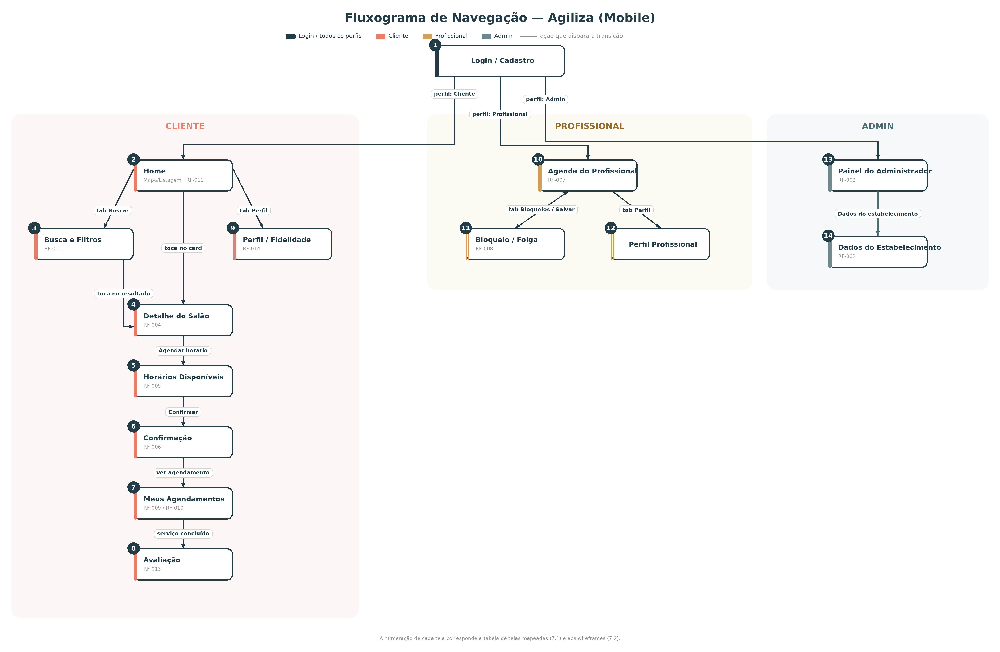

### Detalhamento das telas e componentes nativos

- **Tela 1 – Login / Cadastro**: alterna Cliente/Profissional/Admin em um *segmented control* nativo; o campo de e-mail abre teclado no formato `email-address` (atalho de "@" e domínios); o campo de senha usa entrada segura (`secureTextEntry`) com ícone de mostrar/ocultar.
- **Tela 2 – Home (Mapa/Listagem)**: logo abaixo da busca, uma faixa horizontal de *chips* de categoria (Todos/Cabelo/Unhas/Estética) permite pré-filtrar o mapa e a lista sem sair da tela — a categoria ativa fica destacada e é salva como preferência local (`AsyncStorage`/`SharedPreferences`); solicita a permissão nativa de localização (GPS) do dispositivo para centralizar o mapa nos estabelecimentos próximos (`RF-011`); o campo de busca abre o teclado padrão do sistema; a lista de destaques suporta o gesto de *pull-to-refresh*.
- **Tela 3 – Busca e Filtros**: os filtros (serviço, avaliação, horário) abrem em uma *bottom sheet* nativa sobre a própria tela, sem navegar para uma tela nova; a faixa de preço usa um *slider* nativo de dois pontos; categorias aparecem como *chips* selecionáveis por toque, no mesmo padrão da faixa de categoria da Home.
- **Tela 4 – Detalhe do Estabelecimento**: cabeçalho recolhível (*collapsing header*) ao rolar a tela para baixo; as abas internas "Serviços / Profissionais / Avaliações" respondem tanto a toque quanto a *swipe* horizontal, padrão nativo de `TabView`.
- **Tela 5 – Horários Disponíveis**: seletor de data em carrossel horizontal com *scroll* nativo; a grade de horários aciona *haptic feedback* (vibração leve) ao selecionar um slot, confirmando o toque sem exigir que o usuário olhe para a tela.
- **Tela 6 – Confirmação de Agendamento**: abre como *bottom sheet modal* (desliza de baixo para cima), sem gesto de "voltar" disponível — único caminho é seguir adiante, reduzindo o risco de reenvio do mesmo agendamento (`RNF-005`).
- **Tela 7 – Meus Agendamentos**: cada item usa o gesto nativo de lista com *swipe actions* (arrastar o card para revelar "Cancelar"), padrão comum em iOS/Android para ações destrutivas contextuais (`RF-009`, `RF-010`).
- **Tela 8 – Avaliação Pós-Atendimento**: nota por toque em componente nativo de estrelas (*tap to rate*); campo de comentário abre teclado padrão com contador de caracteres (`RF-013`).
- **Tela 9 – Perfil / Pontos de Fidelidade**: solicita permissão de notificações locais para avisos de pontos e promoções (`RF-014`); usa o *Share Sheet* nativo do sistema operacional para convidar amigos.
- **Tela 10 – Agenda do Profissional**: lista com *pull-to-refresh*; recebe atualizações em tempo real via notificação *push* nativa quando um agendamento é confirmado ou cancelado (`RF-007`).
- **Tela 11 – Bloqueio de Agenda / Folga**: campos "De"/"Até" abrem o seletor nativo tipo *wheel picker* (iOS) / *time picker* (Android); a opção "Dia inteiro" usa um `Switch` (toggle) nativo (`RF-008`).
- **Tela 12 – Perfil Profissional**: reaproveita os mesmos componentes nativos de autenticação/segurança da Tela 1 (reconfirmação biométrica) para alterações sensíveis de conta.
- **Tela 13 – Painel do Administrador**: cartões de resumo diário (atendimentos, faturamento, avaliação média) atualizados via *pull-to-refresh*; lista de gestão com o mesmo padrão de linha com *chevron* usado nas telas 9 e 12.
- **Tela 14 – Dados do Estabelecimento**: campos de horário abrem o mesmo *time picker* nativo da Tela 11 (consistência entre Profissional e Admin); dias da semana usam *chips* multi-seleção (mesmo padrão da categoria na Home).

### 7.2. Wireframes Móveis:

### Visão geral de todas as telas lado a lado:
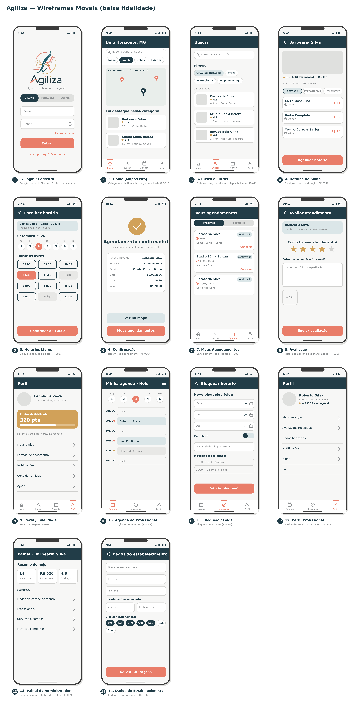


### Telas individuais e usabilidade aplicada

Cada tela abaixo é apresentada isoladamente, com a leitura de usabilidade específica que ela demonstra (uma mão, tabs, hambúrguer ou transição). A numeração é a mesma da tabela "Telas mapeadas" e do fluxograma.

1. Login / Cadastro 
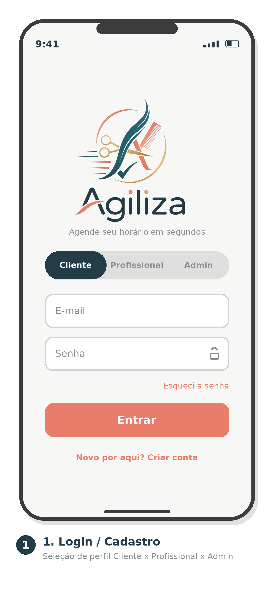 

Logo da marca no topo; botão primário Entrar ancorado na base, dentro da thumb zone, com o link "Novo por aqui? Criar conta" logo abaixo dele; ausência de tabs (fluxo de autenticação é isolado, sem navegação principal ativa).

2. Home – Mapa/Listagem 
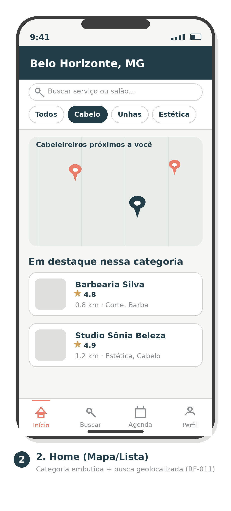 

A pré-seleção de categoria acontece na própria Home: faixa de chips (Todos/Cabelo/Unhas/Estética) logo abaixo da busca, com "Cabelo" ativo no exemplo, tocar em outro chip atualiza mapa e lista sem trocar de tela; barra de tabs fixa na base (Início/Buscar/Agenda/Perfil) inaugura a navegação por guias do perfil Cliente.

3. Busca e Filtros 
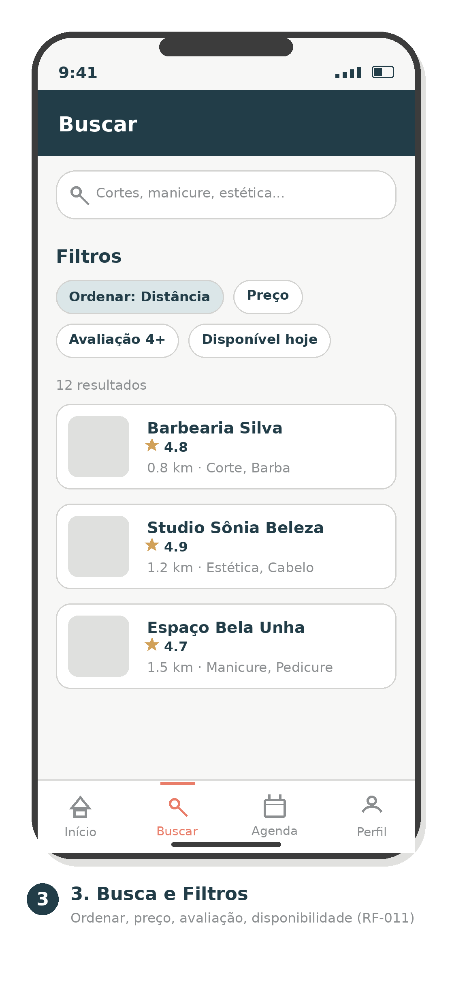 

Reaproveita o mesmo padrão de chips da Home (agora para ordenar/filtrar) e a mesma barra de tabs (aba "Buscar" ativa); lista de resultados no mesmo formato de card usado na Home, mantendo a leitura previsível.

4. Detalhe do Estabelecimento 
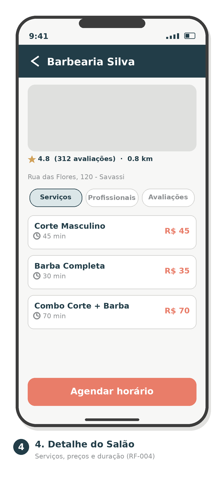 

Transição em pilha a partir da Home ou da Busca (seta de "voltar" no cabeçalho); botão Agendar horário fixo na base.

5. Horários Disponíveis 
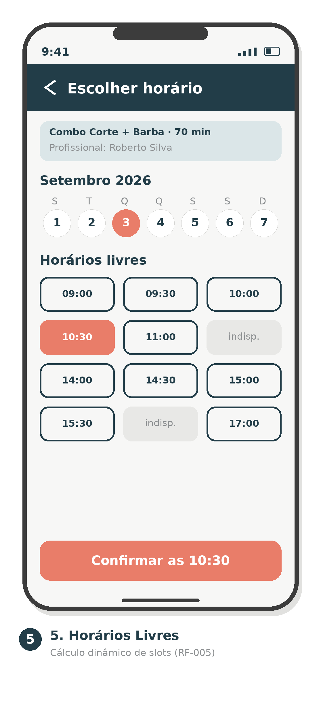 

Continua a transição em pilha (voltar no cabeçalho); estados de slot (disponível/selecionado/indisponível) e botão de confirmação na base tornam a ação possível só com o polegar.

6. Confirmação de Agendamento 
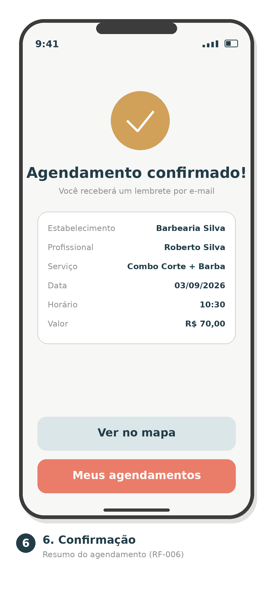 

Rompe a pilha de propósito: sem seta de "voltar" no cabeçalho — abre como modal (bottom sheet) para impedir reenvio do mesmo agendamento; as duas ações de saída (Ver no mapa, Meus agendamentos) ficam empilhadas na base, ambas com boa distância do rodapé do aparelho.

7. Meus Agendamentos 
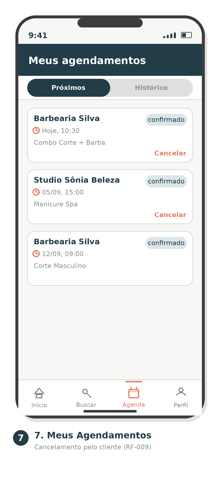 

Retorna à navegação por tabs (aba "Agenda" ativa); ação "Cancelar" pensada para gesto de swipe lateral no card, sem precisar abrir uma nova tela.

8. Avaliação Pós-Atendimento 
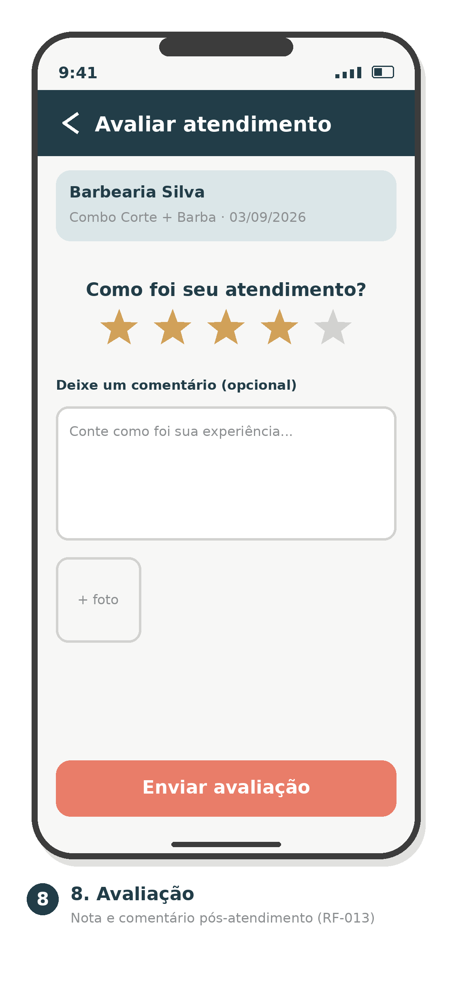 

Transição em pilha a partir de "Meus Agendamentos" (voltar no cabeçalho); nota por toque num componente grande de estrelas — alvo de toque generoso, pensado para um único gesto — com o comentário e o botão Enviar avaliação mantidos abaixo, sempre alcançáveis com o polegar.

9. Perfil / Fidelidade 
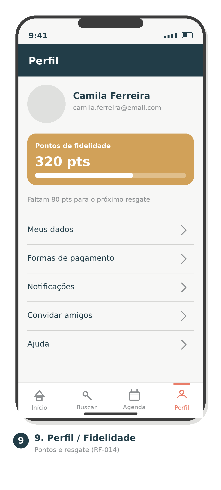 

Acessível pela tab "Perfil"; cartão de pontos com barra de progresso até o próximo resgate; lista de opções em linhas com chevron, padrão nativo de tela de configurações, cada linha já é um alvo de toque de altura confortável.

10. Agenda do Profissional 
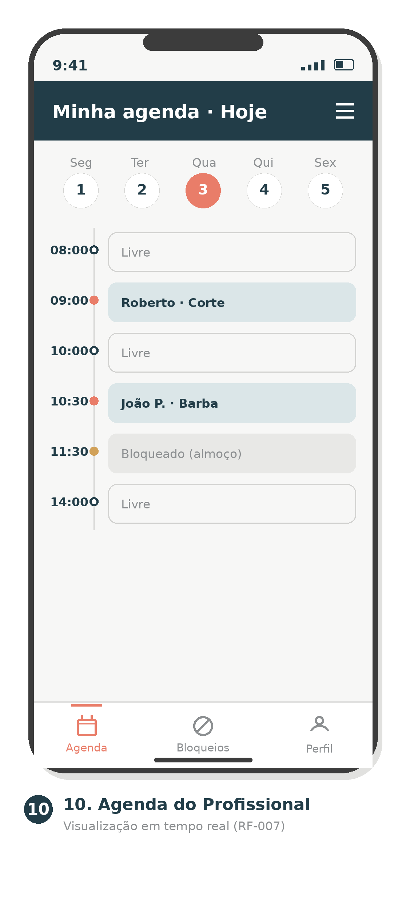 

Introduz o menu ☰ (hambúrguer) no cabeçalho para ações secundárias do Profissional (notificações, sair), enquanto a navegação primária permanece nas tabs da base (Agenda/Bloqueios/Perfil).

11. Bloqueio de Agenda / Folga 
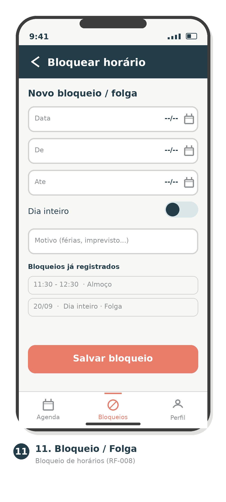

Transição em pilha a partir da Agenda (voltar no cabeçalho); Switch de "Dia inteiro" e botão Salvar bloqueio na base.

12. Perfil Profissional
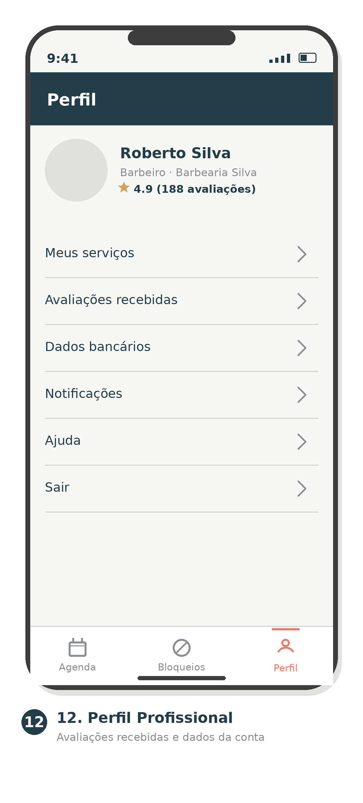 

Mesmo padrão de lista com chevron da Tela 9, agora para dados do Profissional (serviços, avaliações recebidas, dados bancários); tab "Perfil" ativa na barra do Profissional (Agenda/Bloqueios/Perfil).

**13. Painel do Administrador**

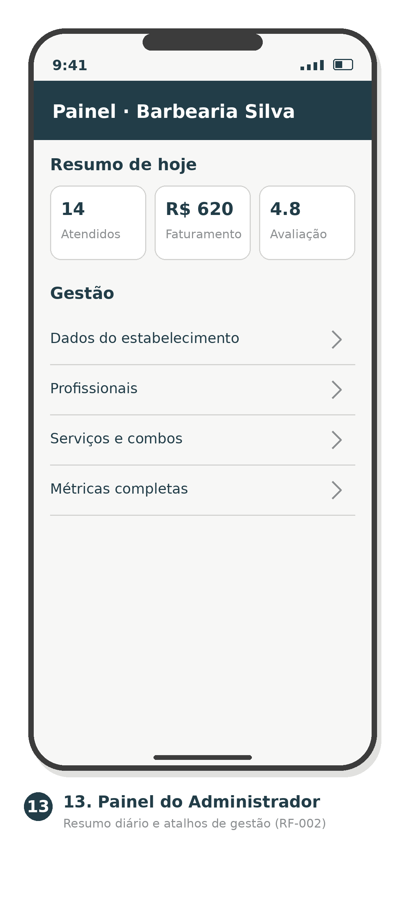

Tela de entrada do perfil Admin (RF-002): cartões de resumo do dia seguidos de uma lista de atalhos de gestão.

**14. Dados do Estabelecimento**

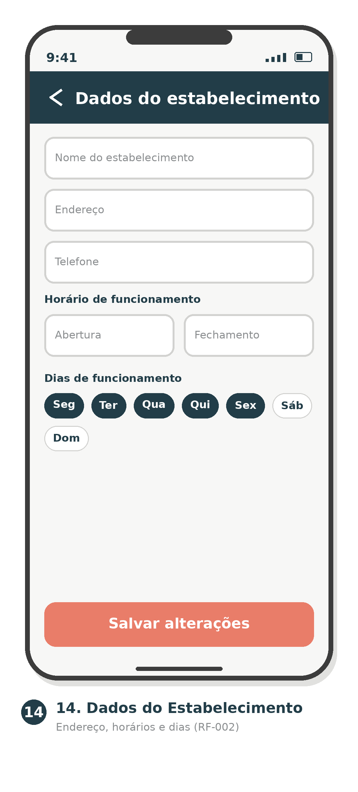

Transição em pilha a partir do Painel (voltar no cabeçalho); formulário com campos de texto, dois seletores de horário lado a lado e chips de dia da semana com multi-seleção; botão `Salvar alterações` fixo na base, com a mesma folga de respiro das demais telas.


# 8. Referências Acadêmicas e de Engenharia

1. **GOMES, André.** *A cada hora, 27 negócios de beleza são abertos no país. Crescimento foi de 18,5% em 2025*. Agência Sebrae de Notícias, 16 jan. 2026. Disponível em https://agenciasebrae.com.br/cultura-empreendedora/a-cada-hora-27-negocios-de-beleza-sao-abertos-no-pais-crescimento-foi-de-185-em-2025/. Acesso em: ago. 2026.

2. **AGÊNCIA SEBRAE DE NOTÍCIAS.** *Com 700 novos pequenos negócios abertos por dia, Brasil se consolida no segmento de beleza*. Agência Sebrae de Notícias, 18 set. 2024. Disponível em https://agenciasebrae.com.br/economia-e-politica/com-700-novos-pequenos-negocios-abertos-por-dia-brasil-se-consolida-no-segmento-de-beleza/. Acesso em: ago. 2026.

3. **GOMES, André.** *Lei Salão Parceiro: tudo o que donos e profissionais da beleza precisam saber*. Agência Sebrae de Notícias, 31 mar. 2026. Disponível em https://agenciasebrae.com.br/economia-e-politica/lei-salao-parceiro-tudo-o-que-donos-e-profissionais-da-beleza-precisam-saber/. Acesso em: ago. 2026.
